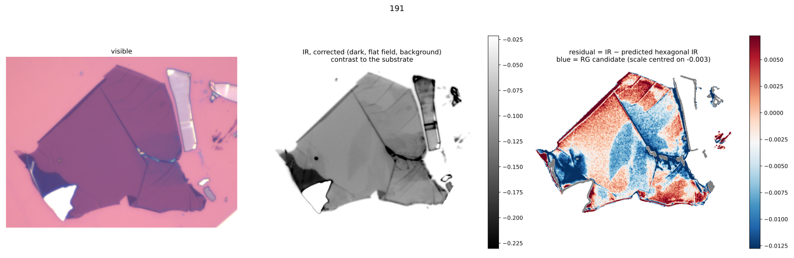

# irvis-residuals

**Find rhombohedral (ABC) graphite in few-layer graphite flakes from one visible and one infrared optical image.**

Rhombohedral graphite is darker in the infrared than hexagonal (Bernal, ABA) graphite of the same thickness. In the visible, the two look the same. This tool predicts, from the visible colour of every pixel, how dark *hexagonal* graphite would be in the IR, and subtracts that from the measured IR image. What remains, the **residual**, is close to zero on hexagonal graphite and **negative (blue) on rhombohedral candidates**.



Each run produces three images on one pixel grid:
1. **the visible image**;
2. **the corrected IR measurement**: contrast to the substrate, with dark frame, flat field and background removed;
3. **the residual**: IR minus the predicted hexagonal IR.

It takes about 5–10 s per flake on a laptop. The tool shows *candidates*; confirm them with Raman spectroscopy.

---

## Installation

```bash
git clone https://github.com/nemeslab-MFA/ir_vision.git
cd ir_vision
pip install -r requirements.txt          # numpy, scipy, scikit-image, tifffile, matplotlib
```

Python 3.9 or newer.

## Quick start: the demo

Two example flakes are included, with Raman-confirmed rhombohedral areas:

| Flake | Data |
|---|---|
| `demo/191` | VIS, two IR images (flake shifted between them), dark frame, 5 flat-field frames |
| `demo/80_02` | VIS, one IR image, dark frame, 8 flat-field frames |

```bash
python residuals.py demo --batch
```

Results appear in `demo/191/residuals/` and `demo/80_02/residuals/`. Compare them with the reference figures in `demo/expected/`. The blue domains correspond to the Raman-confirmed rhombohedral areas: the domains in the centre and on the left of 191, and the dark left-hand strip of 80_02.

The demo VIS images are stored at 1600 px, the size the tool works at internally, to keep the repository small. Full-size camera images give the same result (tested: correlation 0.9996).

## Your own measurements

Put one flake per folder:

```
my_flake/
  vis.tif                    VIS image, RGB (8 or 16 bit)
  ir1.tif                    IR image, raw 16-bit
  ir2.tif                    optional: same flake shifted by ~1/4 field (recommended)
  dark1.tif, dark2.tif ...   IR with the lamp blocked, same IR settings (required)
  flat1.tif ... flat5.tif    IR of bare substrate, stage moved between frames (strongly recommended)
```

```bash
python residuals.py my_flake                  # one flake  -> my_flake/residuals/
python residuals.py all_my_flakes --batch     # every sub-folder
python residuals.py my_flake --part thick     # + figures of the thick part only
python residuals.py --vis V.tif --ir A.tif --ir2 B.tif --dark "dark*.tif" --flats "flat*.tif" --out out --name flake7
```

Files are recognised by name (`dark*`/`black*`, `flat*`) and by type (the RGB image is the VIS image). How to take the images: [`docs/IMAGING_PROTOCOL.md`](docs/IMAGING_PROTOCOL.md) (step by step) and [`docs/MEASUREMENT_CHECKLIST.md`](docs/MEASUREMENT_CHECKLIST.md) (one-page checklist).

### Output

| File | Contents |
|---|---|
| `<name>_residual.svg` | combined figure: visible, corrected IR, residual |
| `<name>_1_visible.svg` | visible image (same crop and look as in the combined figure) |
| `<name>_2_ir_corrected.svg` | corrected IR: contrast to the substrate, with colour bar |
| `<name>_3_residual.svg` | residual, colour scale centred on the flake median, with colour bar |
| `<name>_summary.txt` | files used, residual level, warnings |
| `data/<name>_vis.tif` | visible image on the IR pixel grid (RGB, 8 bit), for analysis |
| `data/<name>_ir_corrected.tif` | corrected IR contrast (float32; −0.10 = 10 % darker than the substrate) |
| `data/<name>_residual.tif` | residual (float32); NaN off the flake and on excluded parts |
| `data/<name>_filled_pixels.tif` | isolated blank pixels (≤ 30 px, e.g. saturated or defect pixels) that were filled from their neighbours |

The SVGs are for viewing (vector graphics: text and colour bars stay sharp at any size; open them in a browser, Inkscape or Illustrator); the TIFFs in `data/` hold the numbers, all on the same pixel grid.

### Options

| Option | Meaning |
|---|---|
| `--no-thick` | keep pixels outside the calibrated colour range (switched on automatically when > 50 % of the flake is outside it) |
| `--part thick` / `--part thin` | also write the figures for the thick (or thin) part only: `<name>_thick_*.svg`, part outlined in yellow, residual scale centred on that part; mask in `data/` |
| `--part-by auto\|ir\|vis` | how the part is found: IR contrast, VIS brightness, or `auto` (IR; VIS when bare substrate covers < 50 % of the VIS image) |
| `--ir-orientation` | keep the IR camera orientation (default: rotated by 180° to match the VIS image) |
| `--calib FILE` | use another calibration (default `calib/calib.npz`) |

## Reading the residual

- **Blue:** darker than hexagonal graphite of the same VIS colour, so a rhombohedral candidate.
- **Compare areas of the same VIS colour (thickness).** Small differences in VIS exposure or white balance shift a whole flake by up to ~±0.01, so the colour scale is centred on the flake's median.
- **Typical signal (rhombohedral − hexagonal):**

  | Flake colour | Signal |
  |---|---|
  | thick, dark blue | −0.015 … −0.02 |
  | purple | −0.004 … −0.01 |
  | thin, light purple | ≈ 0 (not detectable in this IR band) |

- **Not rhombohedral:** thin lines along folds and wrinkles; the outer 1–2 px of a flake edge; isolated dark dots (dust, detector defects).
- **Grey:** left out (VIS-saturated parts, or colours outside the calibration).

## How it works

1. **IR:** `(I − dark) / flat`. A plane fitted on the substrate removes the remaining tilt. If a second, shifted IR image is given, the two are averaged.
2. **VIS:** per-channel contrast to the substrate. The substrate is found on the whole VIS image; the background is a 3rd-order polynomial per channel.
3. **Registration:** the IR camera geometry relative to the VIS camera (scale 0.44 IR px per VIS px at 1600 px, rotation ≈ 180°) is fixed, so only the translation is searched (phase correlation of gradient images).
4. **Hexagonal prediction:** a lookup over the calibration flakes' VIS colours (median IR of the 50 nearest hexagonal calibration pixels), blending into a smooth curve in VIS red contrast where a colour wasn't seen in the calibration.
5. **Residual:** measured IR − prediction.

## Calibration and limits

`calib/calib.npz` was made from **8 flakes with Raman maps**. Hexagonal pixels only were used to train the prediction. Validation: each flake predicted by a model built from the other 7 separates rhombohedral from hexagonal pixels with **AUC 0.88–1.00 on 7 of 8 flakes**. The exception is 0.60 on a flake whose thin parts lie outside the calibrated thickness range. *The two demo flakes are among the 8 calibration flakes.*

The calibration is valid for:
- **90 nm SiO₂/Si** substrate, the same objective and IR camera/filter;
- VIS white balance set on the same white reference (substrate R:G:B ≈ 227:145:175), with VIS channels not saturated;
- flake colours from dark blue (VIS red contrast ≈ −0.70) to light purple (≈ −0.15).

**Flakes that fill the field of view.** The tool also works when there's little bare substrate in the images, with a warning:
- the VIS substrate is taken as the brightest large brightness peak, and its background becomes a plane;
- if the IR field holds no substrate at all, the IR contrast is taken directly from the flat field.

Without substrate around the flake, though, a tilt or illumination gradient across the flake can't be removed. Expect smooth gradients in the residual, and compare only neighbouring areas. **Leave bare substrate around the flake (≥ 25 % of the field) whenever possible.**

The tool **warns** when the VIS image is near saturation, when the white balance differs from the calibration, when most of the flake is outside the calibrated colour range, and when the flat field or the second IR image is missing. Another substrate, objective or camera needs a new calibration; contact the authors.

## Citation and contact

György Kálvin, HUN-REN Centre for Energy Research (EK), Budapest. If you use this tool, please cite: *(add the publication when available)*.

## License

*(to be chosen by the authors before publishing, e.g. MIT or BSD-3-Clause)*
